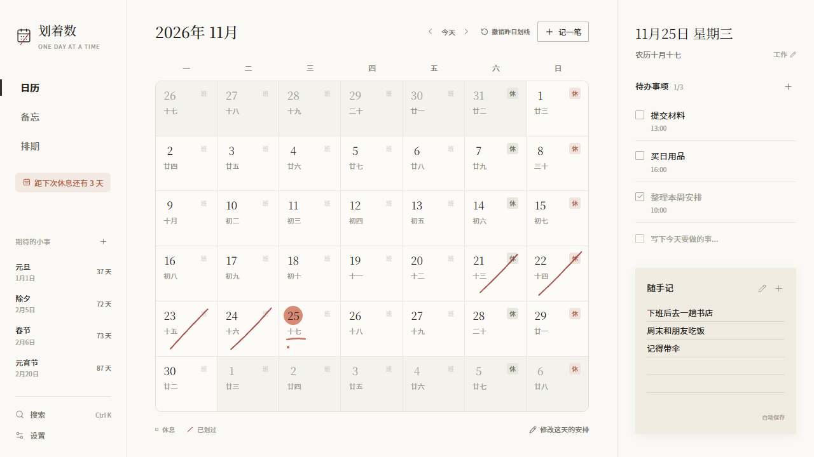
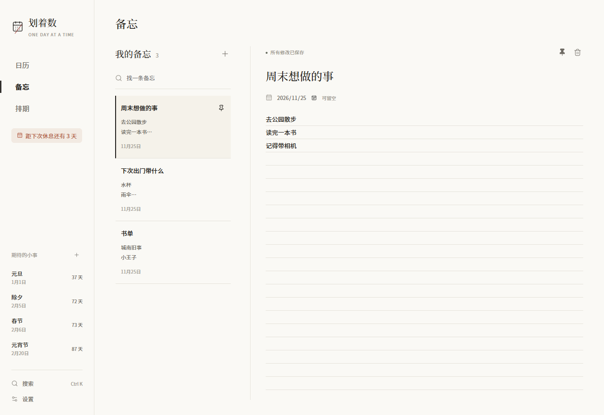
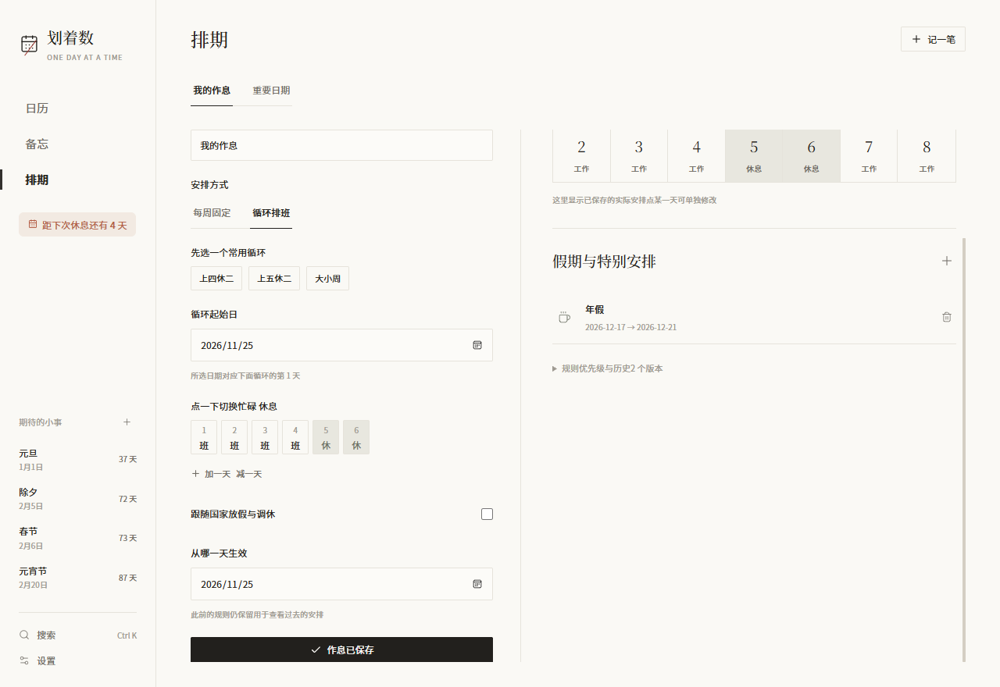
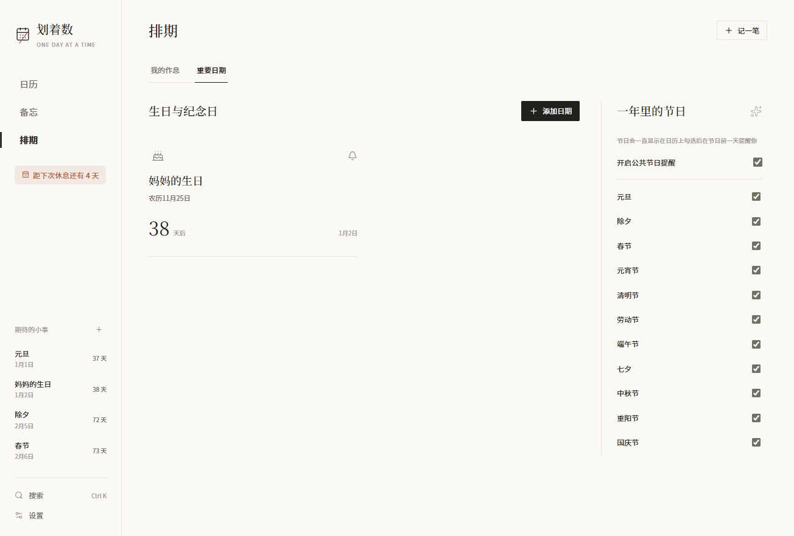

# 划着数

一款本地优先的 Windows 日历、备忘和提醒软件，采用日式宣纸手帐界面。

## 界面预览

### 日历与红笔划日

月历中可以用红笔划掉过去的日子，右侧显示当天待办和随手记。



### 备忘

在横格纸上写备忘，内容自动保存，常看的备忘可以置顶。



### 排班与假期

按自己的作息设置循环排班，也可以单独添加年假、寒暑假等日期区间。



### 节日与重要日期提醒

查看节日倒计时，勾选想提醒的节日，也可以记录生日和纪念日。



## 安装与使用

安装包位于 `release/Huazheshu-0.3.0-Setup.exe`，支持具备 .NET Framework 4.8 和 WebView2 Runtime 的 Windows 10/11 x64。安装后从桌面或开始菜单打开“划着数”。已有版本可以直接覆盖安装。

轻量版使用系统共享的 WebView2 Runtime。较旧的 Windows 若缺少该组件，可从 [Microsoft WebView2](https://developer.microsoft.com/microsoft-edge/webview2/) 安装 Evergreen Runtime。组件就绪后，查看和编辑记录无需联网。

- **日历**：点日期查看当天内容，点“记一笔”添加待办、备忘或重要日期。
- **三栏布局**：左侧导航与休息倒计时，中间完整月历，右侧当天待办和横格便签；列表在各自区域内滚动。
- **快捷记录**：右侧待办输入框按回车新增；便签停笔约半秒自动保存，切换日期和页面时也会保存输入。
- **划掉一天**：点“划掉昨天”，也可以在过去的日期格里用鼠标划线；选中那一天可以撤销。划线不会完成或删除事项。
- **备忘**：纯文本编辑，停止输入约半秒后自动保存；支持置顶、日期关联和搜索。`Ctrl+K` 打开全局搜索。
- **排期**：选择每周固定安排，或设置锚点和循环班次；支持大小周、上四休二、学期起止及寒暑假。两周预览显示保存后的真实安排。
- **假期与例外**：单日修改优先于日期区间，区间优先于国家调休和基础作息。重叠区间以最后保存的为准。修改基础作息可以指定生效日，保留历史版本。
- **重要日期**：支持公历、农历和闰月生日；闰月生日没有对应闰月的年份按同名平月处理，缺日取当月末。每年仅生成一次。
- **提醒**：关闭主窗口后会保留托盘，点击托盘图标重新打开。彻底退出或关机时不发送通知，重新启动会补查错过的提醒。休眠唤醒后自动补查；多条提醒合并通知。重复事项各次独立完成。
- **备份**：设置中导出、恢复 JSON 备份或打开数据文件夹。每日首次启动自动保存一份，保留最近七份；恢复前另存当前快照。新版本安装保留用户数据。

Windows 的通知权限、勿扰和专注模式会影响横幅显示。在“设置”中发送测试提醒，并检查通知中心。开机启动默认关闭，可在设置中开启；开发环境不会修改开机启动项。

国家调休内置 2026、2027 两年。未收录年度会明确提示，个人排期和历法节日仍可使用。节日当天、国家放假和自己的实际休假分别计算。

## 开发

构建需要 Windows、.NET SDK 9 或更新版本、Node.js 24 和 pnpm 11。首次构建从 NuGet 下载 Windows 托盘和 WebView2 所需的构建依赖。

```powershell
pnpm install --frozen-lockfile
pnpm dev
```

```powershell
pnpm test       # 排期、重复、农历、提醒、SQLite 和备份测试
pnpm build      # TypeScript 检查与构建
pnpm test:ui    # WebView2 桌面窗口的操作、重启和升级兼容性测试
pnpm dist      # 生成 Windows x64 NSIS 安装包
```

使用 `pnpm start` 运行已经构建的客户端。数据目录为 `%APPDATA%\划着数`，数据库为 `huazheshu.sqlite`，备份位于 `backups`。界面缓存位于 `%LOCALAPPDATA%\Huazheshu\WebView2`。覆盖安装继续读取现有数据库和备份。

集成测试使用独立临时目录，不访问正式数据。测试可通过 `HUAZHESHU_DATA_DIR` 指定数据目录，通过 `HUAZHESHU_TEST=1` 禁用单实例锁和开机启动注册。

## 结构

- `src/shared`：日期、节日、排期、重复事项、提醒和输入验证。
- `src/host`：将共享规则编译为 Windows 宿主可调用的程序。
- `native`：Windows 窗口、托盘、系统通知和 SQLite 存储。
- `src/renderer`：React 界面，以及连接 WebView2 和宿主的类型化接口。
- `tests`：规则、存储和桌面操作测试。

界面只加载随安装包提供的本地资源。没有账号、云同步、遥测或远程内容加载。数据库和手动备份没有加密，请在自己的 Windows 用户账户中保存。

## 来源和许可

界面按照项目提供的日式宣纸手帐设计规范实现，产品界面与图标独立实现。

国家放假调休来源：

- [2026 年安排：北京市政府转载国务院办公厅通知](https://www.beijing.gov.cn/cs/gncs/zcwj/202603/t20260327_4568275.html)
- [2027 年安排：中国就业网转载国务院办公厅通知](https://chinajob.mohrss.gov.cn/h5/c/2026-11-09/635850.shtml)

界面使用 React、Lucide、Zod 和 lunar-typescript。Windows 宿主使用 WebView2 SDK、Jint 和 Newtonsoft.Json。第三方许可随程序分发，自有源码采用 MIT 许可。

当前安装包没有付费代码签名证书。正式公开发布时应增加代码签名，并在干净的 Windows 10/11 环境各验证一次安装、升级和通知。
